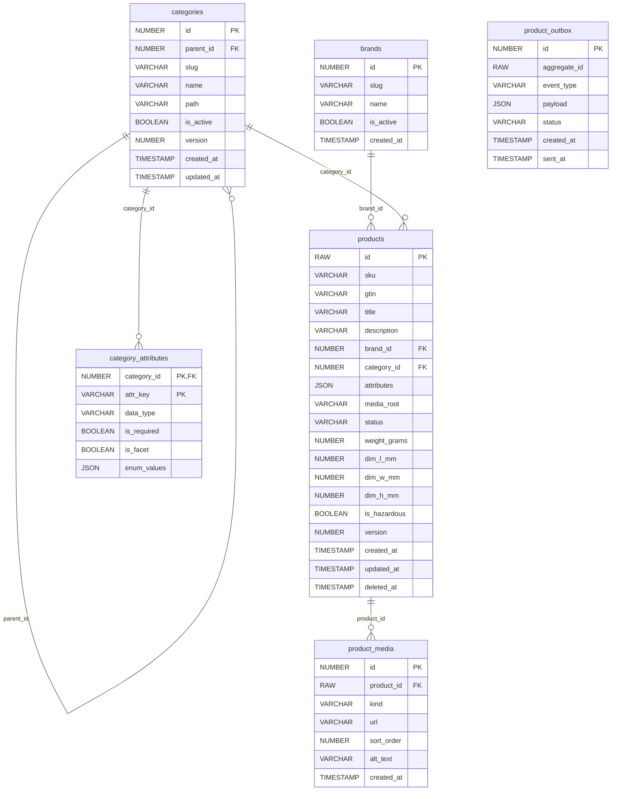

# ShopTrail Product Service

The ShopTrail catalogue: products, brands, categories with attributes, and product media.

Part of **ShopTrail**, a multi-seller marketplace. Full system reference: [`marketplace_tdd.md`](https://github.com/RaghuMHulkoti/shoptrail/blob/main/docs/marketplace_tdd.md).

| | |
|---|---|
| Live | https://product-service-1o2l.onrender.com |
| Swagger UI | https://product-service-1o2l.onrender.com/swagger-ui.html |
| Health | https://product-service-1o2l.onrender.com/actuator/health |
| Local port | `8082` |
| Database | Oracle Autonomous DB, schema `PRODUCT` (Flyway) |
| Stack | Java 25, Spring Boot 4.1, Spring Data JPA, Flyway |

## Responsibilities

- Create, update, list and soft-delete products (status `DRAFT`, `ACTIVE`, `HIDDEN`, `DELISTED`).
- Brands, a category tree, and typed category attributes (string, number, bool, enum; required and facet flags).
- Product media (images, videos, documents).
- Internal lookups for cart and other services.

## How it fits

- REST in: the order console (catalogue), the seller portal (create products, brands, categories), cart-service (internal product lookup).
- REST out: supplier-service (offers shown with products).

## Run locally

Prerequisites: JDK 25+, Maven wrapper (included), the Oracle wallet of the shared database.

```bash
export DB_PASSWORD=...                       # Oracle password (never commit it)
export WALLET_DIR=/path/to/Wallet_ECOMMERCE  # unzipped Oracle wallet
./mvnw spring-boot:run
```

Open http://localhost:8082/swagger-ui.html.

### Tests

```bash
./mvnw test
```

Tests run on H2 in Oracle mode.

### Docker

```bash
docker build -t shoptrail-product-service .
docker run -p 8082:8082 -e DB_PASSWORD=... -e WALLET_CWALLET_B64="$(base64 < cwallet.sso)" shoptrail-product-service
```

`docker-entrypoint.sh` unpacks the wallet from `WALLET_CWALLET_B64` when it is set.

## Configuration

All settings come from environment variables. Secrets have no defaults and must never be committed.

| Variable | Default | Purpose |
|---|---|---|
| `WALLET_DIR` | a local path | Folder of the Oracle wallet (local runs). On Render set `WALLET_CWALLET_B64` instead |
| `DB_USERNAME` | `ADMIN` | Oracle user |
| `DB_PASSWORD` | _(none, secret)_ | Oracle password. Required, no default |
| `SUPPLIER_SERVICE_URL` | `https://supplier-service-tha0.onrender.com` | supplier-service base URL |
| `OTEL_EXPORTER_OTLP_ENDPOINT` | `http://localhost:4318` | OTLP endpoint for metrics push (active only with `OTEL_METRICS_EXPORTER=otlp`) |
| `OTEL_SERVICE_NAME` | application name | `service.name` resource attribute |
| `CORS_ALLOWED_ORIGINS` | _(empty)_ | Comma-separated browser origins allowed to call the API. Empty = none. No trailing dot or slash |

## API

Responses are wrapped as `{"status", "message", "body"}`.

| Method | Path | Purpose |
|---|---|---|
| GET | `/api/v1/products` | Page of products |
| GET | `/api/v1/products/{productId}` | One product |
| POST | `/api/v1/products` | Create product |
| PATCH | `/api/v1/products/{productId}` | Update product |
| DELETE | `/api/v1/products/{productId}` | Delete (soft) |
| POST | `/api/v1/products/{productId}/media` | Add an image, video or document |
| GET | `/api/v1/brands` | Brands |
| POST | `/api/v1/brands` | Create brand |
| GET | `/api/v1/categories` | Category tree |
| GET | `/api/v1/categories/{slug}/products` | Products in a category |
| POST | `/api/v1/categories` | Create category |
| POST | `/api/v1/categories/{categoryId}/attributes` | Define a category attribute |
| GET | `/api/v1/internal/products/{productId}` | Product for other services |
| GET | `/api/v1/internal/products` | Products by ids for other services |

## Data model

Schema `PRODUCT`. Full columns and constraints: [section 8 of the reference](https://github.com/RaghuMHulkoti/shoptrail/blob/main/docs/marketplace_tdd.md#8-data-model).



| Table | Holds | Created in |
|---|---|---|
| `categories` | Category tree (`parent_id`, materialised `path`) | `V1__create_product_schema.sql` |
| `brands` | Brands | `V1__create_product_schema.sql` |
| `products` | Products with JSON attributes, dimensions, status | `V1__create_product_schema.sql` |
| `product_media` | Media per product | `V1__create_product_schema.sql` |
| `category_attributes` | Attribute definitions per category | `V1__create_product_schema.sql` |
| `product_outbox` | Product events (written, not relayed yet) | `V1__create_product_schema.sql` |

## Events

None published. `product_outbox` exists for future catalogue events.

## Background jobs

None.

## How it works

- Products belong to one category and optionally one brand; attributes are a JSON document validated against the category's attribute definitions.
- Deletes are soft (`deleted_at`).
- Business and per-layer metrics come from `metrics/BusinessMetrics` and `metrics/LayerMetricsAspect`.

## Deployment

- Render web service (Docker), deployed manually or with `render deploys create <service-id>`.
- Set at least: `DB_PASSWORD`, `WALLET_CWALLET_B64`, `CORS_ALLOWED_ORIGINS` (order console and seller portal origins).
- CI: `.github/workflows/maven.yml` runs `mvn test`, builds the image, smoke-tests the container and pushes it to `ghcr.io`.
- Observability: `/actuator/health` (liveness and readiness probes), Prometheus at `/actuator/prometheus` with business and layer metrics, optional OTLP push.

## Known gaps

- Write endpoints are open; no JWT or role check yet.
- Search is a simple list and category browse (no full-text search).
- Catalogue events are not published.

## License

Copyright (c) 2026 Raghavendra. All rights reserved. The code is published for viewing only; copying or reuse requires written permission. See [LICENSE](LICENSE).
